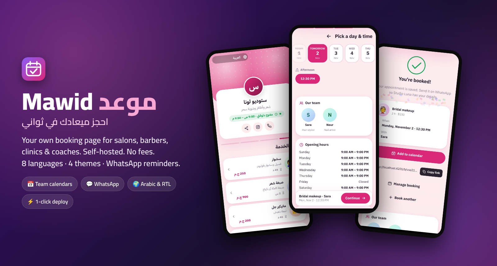
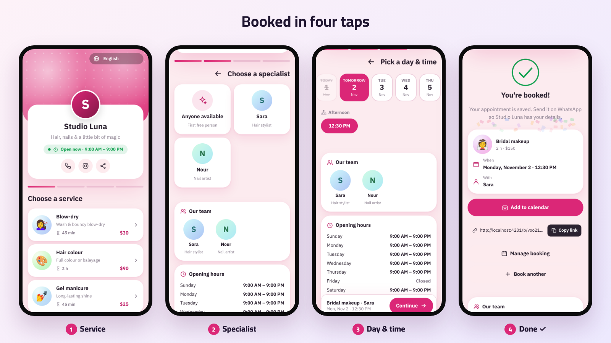
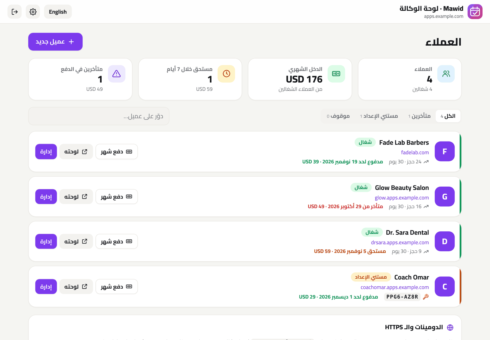

# موعد · Mawid

**صفحة حجز مواعيد خاصة بيك، للحلاقين والصالونات والعيادات والمدربين.**
على سيرفرك، من غير اشتراك شهري، ومن غير عمولات، وبـ 8 لغات.

[English](README.md) · [العربية](README.ar.md)

---

## ليه موعد؟

أغلب الحلاقين والصالونات والعيادات والمدرسين لسه بياخدوا المواعيد بالتليفون وشات الواتساب: رسايل رايحة جاية، وميعادين فوق بعض، وعملاء بينسوا مواعيدهم. البرامج الجاهزة بتحل ده بـ **20 لـ 60 دولار في الشهر لكل موظف**، وغالبًا من غير عربي كويس ولا واتساب.

موعد بيدّي كل مكان **صفحة حجز خاصة بيه** على سيرفره ودومينه:

1. **انشر** التطبيق بضغطة واحدة، والـ HTTPS بيتعمل لوحده.
2. **اختار نوع نشاطك**: حلاق، أو صالون، أو عيادة، أو مدرب. وابدأ بخدمات وفريق جاهزين، أو ضيف بتوعك.
3. **شارك اللينك أو الـ QR.** العميل يختار الخدمة، ثم الشخص، ثم ميعاد فاضي، وخلاص اتحجز. انت بتشوف الحجز على طول، وتفكّره على واتساب بضغطة.

## المميزات

**للعميل**
- 📅 الحجز في 4 خطوات: الخدمة، ثم الشخص (أو "أي حد متاح")، ثم اليوم والساعة، ثم البيانات
- ⏱️ بتظهر بس المواعيد الفاضية فعلًا: مواعيد العمل، وجدول كل شخص، والحجوزات الموجودة، والبريك بين الخدمات، والإجازات
- 📲 بعد الحجز: **إضافة للتقويم** مع تذكير، وواتساب، و**لينك خاص يشوف أو يلغي بيه الحجز**
- 🌍 **8 لغات** والعربي بالكامل، ووضع فاتح وغامق

**لصاحب المكان**
- 🗓️ **لوحة النهارده**: جدول اليوم، والحجوزات المستنية تأكيد، والإيراد ومقارنته بالفترة اللي قبلها، ونسبة اللي ماجوش، وأكتر الأيام زحمة
- 🔔 **تذكير عملاء بكرة على واتساب** بضغطة واحدة برسالة جاهزة ومترجمة، والأرقام المحلية بياخدوا كود الدولة لوحدهم
- 📆 **تقويم أسبوعي** لكل شخص أو للفريق كله. دوس على مكان فاضي عشان تضيف حجز، أو على حجز عشان تأكده أو تقفله أو تغيّر ميعاده
- ☎️ **حجز يدوي** للي بيتصلوا أو بييجوا من غير ميعاد، وبرضه مستحيل يتحجز ميعادين فوق بعض
- 👥 **الفريق**: لكل شخص مواعيد شغل وإجازات خاصة بيه، وكل خدمة ممكن تتحدد لأشخاص معينين
- 💳 **العربون**: اطلب من اللي بيحجز أونلاين نسبة مقدّمًا بإنستاباي أو فودافون كاش أو لينك دفع، والحجز يفضل مستني لحد ما تأكد إن العربون وصل
- 📲 **إشعارات تيليجرام فورية** لكل حجز جديد أو إلغاء
- 🎨 **المظهر**: 4 ثيمات (عصري، وناعم، وفخم، وجريء)، و5 خطوط عربي، وأي لون، مع **معاينة حية على شكل موبايل**
- 🔌 **توصيلات اختيارية**: دفع أونلاين (Paymob وStripe)، رسايل واتساب أوتوماتيك، إيميل، إشعارات على الموبايل، ونسخ احتياطي يومي (التفاصيل في **التوصيلات** تحت)

## النشر

### الطريقة 1: ضغطة واحدة على Hostinger VPS

1. اضغط **Deploy on Hostinger** فوق.
2. **لو عايز HTTPS:** وجّه سجل الـ A بتاع الدومين للسيرفر، وحط `DOMAIN=book.example.com`.
3. **كود الإعداد:** هتلاقيه في لوج حاوية `mawid` (السطر `Setup code`)، أو حدده بنفسك في `SETUP_CODE`.
4. افتح الدومين وادخل على `/admin`، واكتب الكود، وكمّل الإعداد.

### الطريقة 2: Node.js web app على هوستنجر

ضيف الريبو من hPanel، واختار Express، وحط المتغيرين `SETUP_CODE` و `DATA_DIR` (لفولدر برّه فولدر التطبيق).

## العربون

عشان اللي بيحجز وما بييجيش، تقدر تطلب عربون على الحجوزات الأونلاين. من **الإعدادات ← العربون** حدد:

- **عربون للحجوزات الأونلاين**: نسبة من سعر الخدمة (`0` يعني من غير عربون)
- **العميل يدفع إزاي**: مثلًا `InstaPay: name@instapay · فودافون كاش 010…`
- **لينك دفع** (اختياري): أي صفحة دفع زي Paymob أو PayPal

بعد الحجز العميل بيشوف المبلغ وطريقة الدفع وزرار **ادفع دلوقتي** في صفحة التأكيد وفي لينك الحجز الخاص بيه. الحجز بيفضل **مستني** لحد ما تدوس **العربون وصل** من شاشة النهارده أو من الحجز نفسه، وساعتها بيتأكد. الحجوزات اللي بتضيفها بنفسك مش بيتطلب فيها عربون، وموعد من الأساس مش بيلمس الفلوس، فمفيش عمولة ولا مفاتيح دفع. عايزها أوتوماتيك؟ وصّل Paymob أو Stripe والعربون بيتدفع ويتأكد أونلاين (شوف **التوصيلات** تحت).

## إشعارات تيليجرام

توصلك رسالة على موبايلك ببلاش أول ما يوصل حجز جديد أو العميل يلغي، حتى ولو لوحة التحكم مقفولة:

1. في تيليجرام افتح [‎@BotFather](https://t.me/BotFather) وابعت `/newbot`، وانسخ التوكن.
2. حط التوكن في **الإعدادات ← إشعارات فورية (تيليجرام)**، وبعدين افتح البوت الجديد ودوس **Start**.
3. دوس **لاقي المحادثة** وبعدين **ابعت تجربة**.

التوكن بيتحفظ على السيرفر بتاعك بس، ومش بيظهر تاني في المتصفح، ومش بيدخل في النسخة الاحتياطية.

## التوصيلات (اختيارية)

كل حاجة شغالة من غيرها. شغّل اللي محتاجه بس من **لوحة التحكم ← التوصيلات**. المفاتيح وكلمات السر بتفضل على السيرفر بتاعك: عمرها ما بتتبعت للمتصفح ولا بتدخل في النسخ الاحتياطية.

### الدفع أونلاين: Paymob أو Stripe

لما توصّل شركة دفع، العميل بيدفع العربون أونلاين بعد ما يحجز على طول (أو بعدين من لينك الحجز) والحجز بيتأكد لوحده.

- **Paymob** (مصر، السعودية، الإمارات، عمان، باكستان): حط الـ Secret key والـ Public key والـ HMAC وأرقام الـ Integration من لوحة Paymob، وبعدين حط لينك الـ callback اللي ظاهر في اللوحة في خانة *Transaction processed callback*.
- **Stripe** (كل الدول): حط الـ Secret key (`sk_live_…` أو `sk_test_…`). ولو عايز، ضيف Webhook على `https://دومينك/webhooks/stripe` للحدث `checkout.session.completed` وحط الـ signing secret بتاعه.
- كل دفعة بتتأكد من الشركة لما العميل يرجع، وتاني من الـ Webhook لو قفل الصفحة. المبلغ والعملة بيتراجعوا، والدفعة بتتحسب مرة واحدة بس. جرّب بمفاتيح تجريبية وزرار **افتح دفعة تجريبية**.
- طريقة الدفع اليدوي ولينك الدفع بتوعك بيفضلوا شغالين لو مفيش شركة دفع.

### رسايل واتساب أوتوماتيك (WhatsApp Cloud API)

من غيرها، لينكات واتساب بضغطة شغالة زي ما هي. ومعاها، الرسايل دي بتتبعت لوحدها من رقم البيزنس بتاعك:

| الرسالة | بتتبعت إمتى | اسم القالب |
|---|---|---|
| تأكيد الحجز | الحجز يتأكد (تأكيد تلقائي، أو العربون اتدفع، أو انت أكدته) | `mawid_confirmed` |
| تذكير قبلها بيوم | اليوم اللي قبل الميعاد بعد الساعة 10 الصبح | `mawid_reminder` |

1. اعمل App على [Meta for Developers](https://developers.facebook.com/) وضيفله WhatsApp، وانسخ الـ **Phone number ID** و**Access token دائم** (System user).
2. واتساب مش بيسمح للبيزنس يبدأ محادثة غير بقالب متوافق عليه. اعمل كل قالب بالنص اللي ظاهر في اللوحة بالظبط (فيه زرار نسخ)، استنى الموافقة، وبعدين شغّله.
3. **ابعت تجربة** بيبعت قالب `hello_world` بتاع Meta عشان تتأكد إن التوصيل شغال. Meta بتحاسب على المحادثات اللي البيزنس بيبدأها حسب أسعارها.

### الإيميل (SMTP)

أي إيميل ينفع، زي إيميل هوستنجر (`smtp.hostinger.com`، بورت 465 مع SSL/TLS أو 587). لما توصّل الإيميل، العميل يقدر يكتب إيميله (اختياري): بيوصله التأكيد ومعاه دعوة للتقويم، وطلب العربون، وتذكير قبلها بيوم. التنبيهات والنسخة اليومية كل واحدة ليها زرار تشغيل لوحدها.

### إشعارات على الجهاز ده

لوحة التحكم تتثبت على الشاشة الرئيسية للموبايل زي أي تطبيق. دوس **شغّل الإشعارات** على كل جهاز عايزه يوصله إشعار فوري بكل جديد من غير تيليجرام (على الآيفون ضيف اللوحة للشاشة الرئيسية الأول؛ iOS 16.4 أو أحدث). إشعارات تيليجرام لسه شغالة برضه.

### نسخ احتياطي يومي أوتوماتيك

كل يوم التطبيق بيحفظ نسخة في `DATA_DIR/backups/` وبيحتفظ بآخر 14 يوم. تقدر تنزّل أي واحدة من اللوحة، أو تدوس **اعمل نسخة دلوقتي**. شغّل **ابعتلي النسخة الاحتياطية كل يوم** عشان يبقى فيه نسخة مضغوطة برّه السيرفر. وللاسترجاع: **الإعدادات ← نسخة احتياطية ← استرجاع نسخة**. ولو حصل خطأ أو النسخة فشلت، بيوصلك تنبيه (مرة كل ساعة بالكتير).

### باسم وكالتك (White-label)

من لوحة الوكالة (`/hub` ← الإعدادات) حط اسم وكالتك وموقعك: كل صفحات العملاء هتكتب "بواسطة *وكالتك*" بدل موعد، أو تخفي السطر خالص. وشاشة دخول العملاء بتظهر اسمك برضه.

## وضع الوكالة: كل عملاءك على سيرفر واحد

لو إنت فريلانسر أو وكالة، تقدر تشغّل **سيرفر موعد واحد لعملاء كتير**. كل عميل بياخد صفحة حجز مستقل تمامًا (لوحة تحكم وكلمة سر وبيانات وصور خاصة بيه) على `client.yourdomain.com` أو على الدومين بتاعه، وبـ HTTPS أوتوماتيك. وإنت بتدير الكل من لوحة واحدة على `/hub`.

- ➕ **عميل جديد في ثواني**: تختار الاسم والعنوان، وتبعتله اللينك وكود الإعداد على واتساب بضغطة
- 🌐 **دومين فرعي أو دومين العميل نفسه**، والشهادة بتطلع أوتوماتيك أول ما حد يفتح الصفحة
- 💰 **متابعة الاشتراكات**: المبلغ الشهري، ومدفوع لحد إمتى، واللي قرب ميعادهم واللي متأخرين، وزرار "دفع شهر"
- ⏸️ **إيقاف** العميل اللي ما دفعش (صفحته بيظهر فيها "مش متاحة دلوقتي") ورجوعه بضغطة
- 🔑 **كلمة سر جديدة** للعميل اللي نسي كلمة السر
- 🗑️ لما تحذف عميل، بياناته بتتنقل لفولدر `trash/` ومش بتتمسح

**التشغيل** (من فولدر [`examples/agency/`](examples/agency)):

1. وجّه سجلين DNS للسيرفر: `apps.example.com` و`*.apps.example.com`.
2. شغّل ملف الـ compose بـ `BASE_DOMAIN=apps.example.com`.
3. افتح `https://apps.example.com/hub` واكتب كود الإعداد اللي في اللوج.

## فروع كتير

كل فرع بيبقى ليه نسخة مستقلة: لوحة تحكم، وخدمات وفريق وتقويم، وبيانات، ورقم واتساب، وغالبًا على دومين فرعي خاص بيه (`downtown.example.com` و`mall.example.com`). النسخة خفيفة جدًا (حوالي 70 ميجا رام)، فسيرفر صغير يشيل فروع كتير.

في فولدر [`examples/branches/`](examples/branches) هتلاقي `docker-compose.yml` و`Caddyfile` جاهزين لفرعين مع HTTPS أوتوماتيك. عشان تضيف فرع: انسخ بلوك الخدمة، واديله volume جديد، وضيف سطر في الـ `Caddyfile`. وجّه الـ DNS بتاع كل دومين فرعي للسيرفر، وشغّل `docker compose up -d`، وافتح `/admin` على كل دومين عشان تجهّزه. وعلى Hostinger VPS ممكن كمان تنشر القالب أكتر من مرة.

## الترخيص

[MIT](LICENSE)

