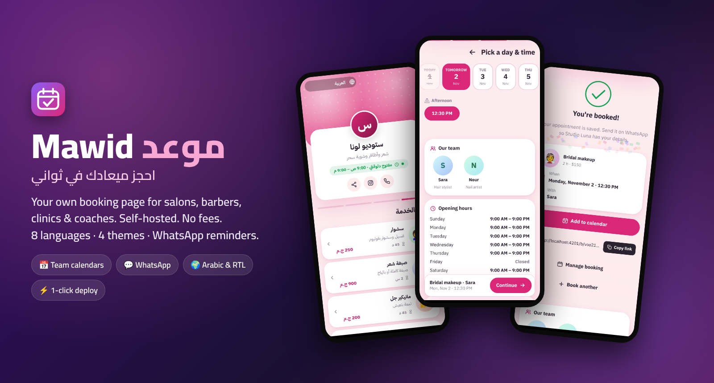
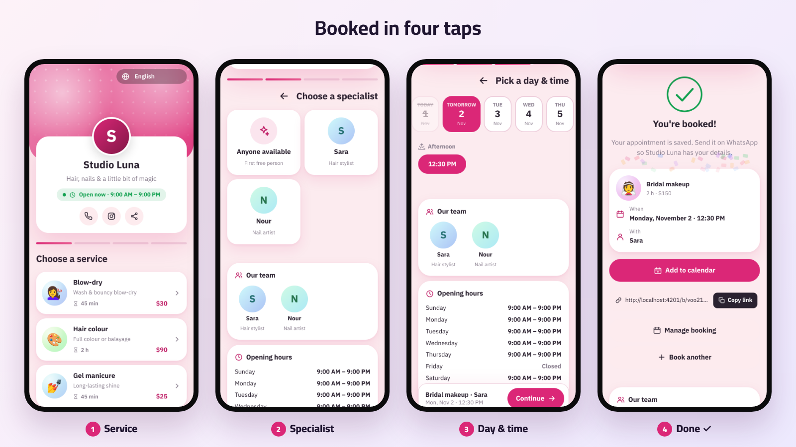
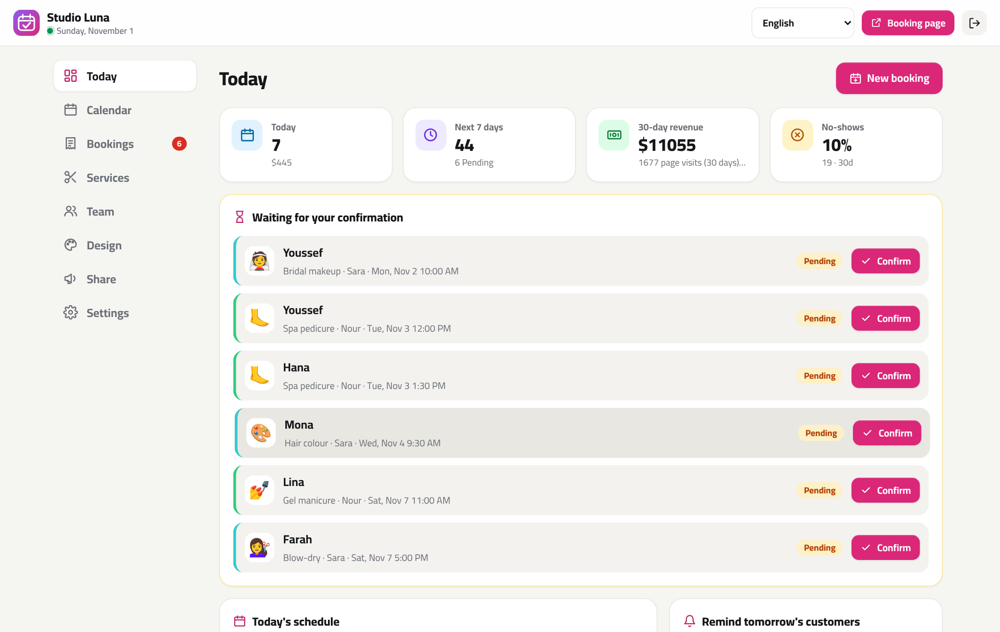
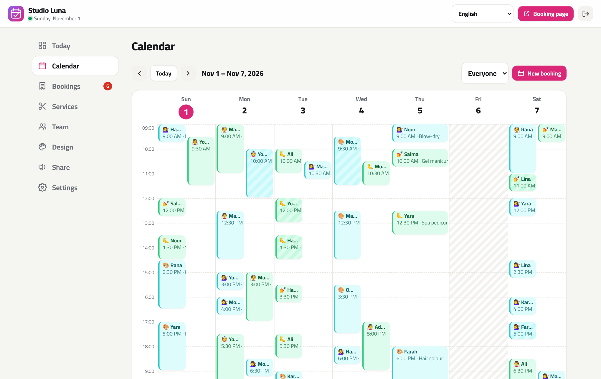
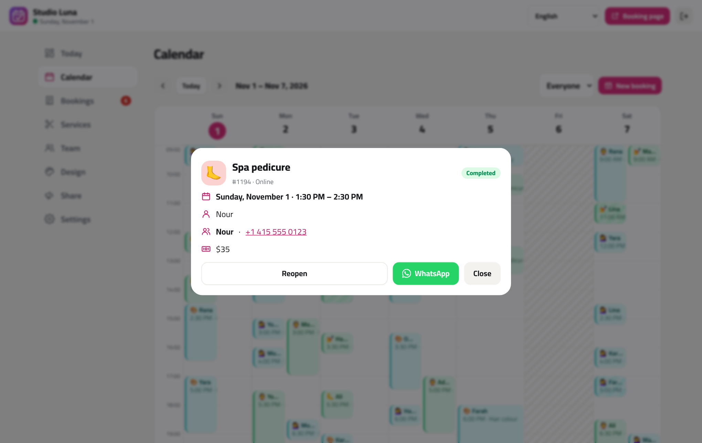
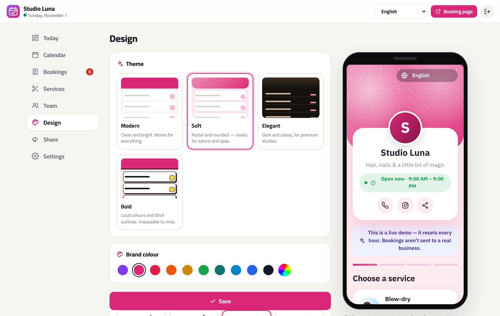
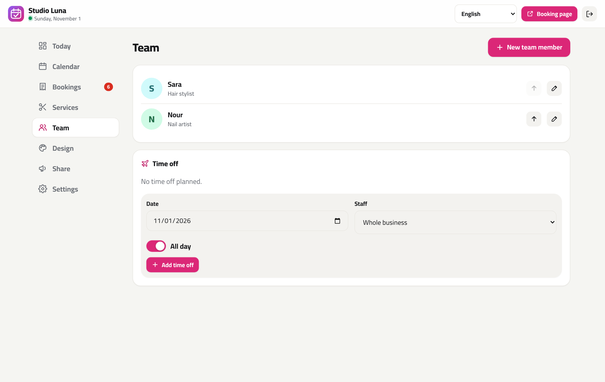
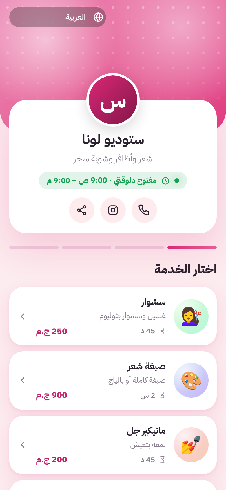

<div align="center">



# Mawid · موعد

**Your own appointment booking page — for salons, barbers, clinics and coaches.**
Self-hosted. No monthly fees. No commissions. 8 languages.

[](https://www.hostinger.com/docker-hosting?compose_url=https://raw.githubusercontent.com/mashraf1997/mawid/main/docker-compose.yml&REFERRALCODE=YOUR_REFERRAL_CODE)

[English](README.md) · [العربية](README.ar.md)

</div>

---

## Why Mawid?

Barbers, salons, clinics, tutors and trainers still book most appointments by phone and WhatsApp chat — back-and-forth messages, double bookings, forgotten appointments. Booking SaaS fixes that for **$20–$60 a month per staff member**, usually without proper Arabic or WhatsApp support.

Mawid gives every business its **own booking page** on its own server and domain:

1. **Deploy** with one click (HTTPS included).
2. **Pick your type of business** — barbershop, beauty salon, clinic, coach — and start with ready-made services and team, or add your own.
3. **Share the link or QR code.** Customers pick a service, a specialist, a free time and they're booked. You see it instantly, and remind them on WhatsApp with one tap.



## Features

**For customers**
- 📅 Book in four taps: service → specialist (or *anyone available*) → day & time → details
- ⏱️ Only truly free times are shown — working hours, each person's schedule, existing bookings, breaks between services and time off are all taken into account
- 📲 Confirmation screen with **Add to calendar** (.ics with a reminder), WhatsApp, and a **private link to view or cancel** the booking
- 🌍 **8 languages** (English, العربية with full RTL, Español, Português, Français, Türkçe, Bahasa Indonesia, हिन्दी), light & dark mode, remembers name and phone

**For the business**
- 🗓️ **Today** dashboard: schedule timeline, requests waiting for confirmation, revenue with trend, no-show rate, busiest days, top services
- 🔔 **WhatsApp reminders for tomorrow's customers** — one tap opens WhatsApp with a ready-made, translated reminder (local numbers get your country code automatically)
- 📆 **Week calendar** per person or for the whole team; click an empty slot to add a booking, click a booking to confirm, complete, mark no-show, cancel or **reschedule** (only free times are offered)
- ☎️ **Manual bookings** for phone calls and walk-ins — your rules don't apply, but double-booking is still impossible
- 👥 **Team**: each person can have their own working hours and **time off**; services can be limited to certain people; "anyone" spreads bookings fairly
- ✂️ **Services** with duration, price and a **break after** (cleanup / rest time)
- ⚙️ **Booking rules**: auto-confirm or approve each booking, slot interval, minimum notice, how far ahead, cancellation window, booking policy
- 🎨 **Design** tab with **4 themes** (Modern, Soft, Elegant, Bold), 5 Arabic-friendly fonts, any colour, logo and cover — with a **live phone preview**
- 🔔 Sound alert for new bookings, QR code and printable poster, backups

**For the server**
- Node.js + Express, **2 dependencies**, no database to set up (atomic JSON files)
- Runs on the smallest VPS
- **Automatic HTTPS** with Caddy, **setup code** to protect a fresh install, **demo mode**
- Tested availability engine (time zones, buffers, overlapping staff, "until midnight" hours)

## Screenshots

| Today | Week calendar | Booking details |
|---|---|---|
|  |  |  |

| Design + live preview | Team & time off | Arabic booking page |
|---|---|---|
|  |  |  |

What the business receives on WhatsApp:

```text
📅 *New booking #1042*
🏪 Studio Luna
━━━━━━━━━━
💅 Gel manicure · 45 min — $25
👤 With: Nour
🗓️ Tuesday, November 3 · 2:30 PM
━━━━━━━━━━
🙋 Customer: Maya Haddad
📞 Phone: +1 415 555 0142
```

## Deploy

### Option 1 — One click on a Hostinger VPS (recommended)

1. Click **Deploy on Hostinger** above. Docker Manager reads [`docker-compose.yml`](docker-compose.yml), which runs Mawid behind [Caddy](https://caddyserver.com).
2. **HTTPS:** point your domain's DNS **A record** at the VPS and set `DOMAIN=book.example.com`. Caddy gets the certificate automatically.
3. **Setup code:** open the `mawid` container's **logs** in Docker Manager and copy `Setup code: XXXX-XXXX` — or set your own with `SETUP_CODE`.
4. Open your domain, go to `/admin`, enter the code and finish the 1-minute setup.

### Option 2 — Hostinger Node.js web app

1. hPanel → **Websites → Add website → Node.js app → Import Git repository**, pick your fork.
2. Framework **Express**, Node **20+**, entry file `server.js`.
3. Environment variables: `SETUP_CODE` (any code you choose) and `DATA_DIR` (a folder **outside** the app folder, e.g. `/home/<user>/mawid-data`).
4. Deploy and open `/admin`.

### Option 3 — Docker anywhere

```bash
curl -O https://raw.githubusercontent.com/mashraf1997/mawid/main/docker-compose.yml
```

```bash
DOMAIN=book.example.com docker compose up -d
```

```bash
docker compose logs mawid | grep "Setup code"
```

### Option 4 — Plain Node.js

```bash
git clone https://github.com/mashraf1997/mawid.git
cd mawid
npm install --omit=dev
npm start
```

## Configuration

| Variable | Default | Description |
|---|---|---|
| `PORT` | `3000` | HTTP port |
| `DATA_DIR` | `./data` (`/data` in Docker) | Settings, services, team, bookings, photos |
| `SETUP_CODE` | random, printed in the logs | Required to create the admin account on a fresh install |
| `DOMAIN` | *(empty)* | **docker-compose only.** Your domain for automatic HTTPS |
| `TRUST_PROXY` | `loopback, linklocal, uniquelocal` | Express `trust proxy` setting |
| `DEMO_MODE` | `false` | Public demo that resets itself (see below) |
| `DEMO_PASSWORD` | `demo1234` | Admin password shown in the demo |
| `DEMO_RESET_MINUTES` | `60` | Demo reset interval |
| `DEMO_LANG` / `DEMO_TYPE` | `en` / `salon` | Demo language and business type (`barber`, `salon`, `clinic`, `coach`, `other`) |

### Live demo

```bash
docker run -d -p 80:3000 -e DEMO_MODE=true ghcr.io/mashraf1997/mawid:latest
```

A salon with a team, a month of realistic bookings and visitor stats. Visitors can log in with the password shown on screen; password changes and restores are disabled, and everything resets every hour.

### How availability works

For each day, Mawid takes the business hours (or the person's own hours), steps through start times every *slot interval*, and keeps a time only if the whole service **plus its break** fits before closing and doesn't overlap any other booking (including that booking's break) or time off. Times inside the *minimum notice* or beyond the *booking horizon* are hidden. When a customer picks *anyone*, the booking goes to whoever is free with the fewest bookings that day. The engine lives in [`src/availability.js`](src/availability.js) and has its own test suite.

## Security

- A fresh install can only be claimed with the **setup code**.
- scrypt password hashing, signed `HttpOnly` / `SameSite=Strict` session cookies, CSRF header check, rate-limited login, setup and booking endpoints.
- Every booking is re-validated on the server against live availability — no double booking even if two people tap the same time.
- Each customer's manage link uses a random 96-bit token.

## Development

```bash
npm install
npm run dev
npm test       # availability engine, API and locale tests
```

```
src/availability.js  free-slot engine
src/bookings.js      validation, WhatsApp messages, .ics files
src/app.js           routes & API
src/views.js         booking page, manage page, QR poster
locales/             one JSON file per language
public/              booking page & admin (vanilla JS + CSS)
```

## License

[MIT](LICENSE)
